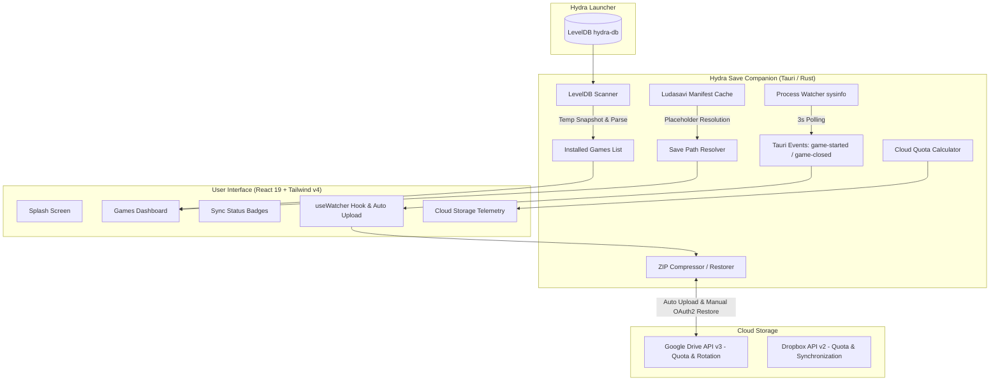

<div align="center">

# 🎮 Hydra Save Companion (HSC)

**The automatic cloud save synchronization companion for [Hydra Launcher](https://github.com/hydralauncher/hydra).**

Automatically back up, sync, and restore your PC game saves across the cloud without tedious manual configuration.

[](https://tauri.app/)
[](https://www.rust-lang.org/)
[](https://react.dev/)
[](https://www.typescriptlang.org/)
[](https://tailwindcss.com/)
[](LICENSE)

[Features](#-key-features) • [Architecture](#-architecture--how-it-works) • [Installation](#-installation--getting-started) • [Configuration](#-environment-variables) • [Roadmap](#-roadmap)

---

</div>

## 💡 Why Hydra Save Companion?

**[Hydra Launcher](https://github.com/hydralauncher/hydra)** is a powerful open-source game launcher. While official cloud save synchronization exists in Hydra, it is **locked behind a paid subscription / tier**. 

For players who prefer not to pay a recurring fee or who already have plenty of unused storage on their own cloud providers (Google Drive, Dropbox), **Hydra Save Companion (HSC)** provides a **100% free, open-source, bring-your-own-cloud alternative**:
- Reads your installed game library directly from **Hydra Launcher**.
- Automatically locates the exact save path for each game using the vast community-driven **Ludasavi** database.
- Monitors game processes in the background and **uploads your saves to your own cloud as soon as you exit a game**.
- **Detects newer saves in the cloud** and lets you download or restore them with a single click.

---

## ✨ Key Features

### 🔄 Seamless Cloud Sync & Backup History
- **Automatic Upload on Game Exit**: Detects when a game process exits and waits for a brief safety cooldown (45 seconds) to ensure all disk writes are finished before packing files into a `.zip` archive and uploading.
- **5-Version Retention & Rotation**: Automatically retains the 5 most recent backups per game with a rolling rotation policy. A dedicated restore modal lets you restore any past save point with one click.
- **Safe Manual Download & Restore**: Cloud downloads are never applied automatically in the background to avoid accidental overwrites during gameplay. You choose when to restore a save (from the game card or the history modal).
- **Accurate Timestamp Preservation**: Local and remote modification dates are normalized to UTC and tracked down to the second.
- **Live Cloud Telemetry**: Real-time footer indicators displaying used, total, and available storage on your connected cloud provider (Google Drive, Dropbox) with a sleek, responsive mini gauge.

### 🧠 Intelligent Save Location Resolution
- **Ludasavi Manifest Integration**: Downloads and caches the official [Ludasavi](https://github.com/mtkennerly/ludasavi-manifest) manifest covering save paths for over 10,000 PC games.
- **Dynamic Path Resolution**: Supports environment variables (`%APPDATA%`, `%LOCALAPPDATA%`, `Saved Games`, `Documents`, Linux `$HOME` directories, etc.) and Steam user IDs (`SteamID` via Windows registry or directory inspection).
- **DRM Emulator Support**: Tailored heuristics to locate saves generated by common emulator wrappers (RUNE, CODEX, TENOKE, EMPRESS, Goldberg SteamEmu, FLT, Razor1911, and more).

### 🎮 Native Hydra Launcher Integration
- **Direct LevelDB Access**: Safely queries Hydra Launcher's local LevelDB database (`hydra-db`) via temporary snapshot copies to avoid file locks.
- **Smart Filtering**: Displays only installed, active games with valid executables (excluding official Steam imports that already possess native cloud synchronization).

### 🖼️ Polished UI & Rich Visuals
- **Animated Splash Screen**: Smooth startup screen featuring the official logo and a progress bar during game discovery and integrity checks.
- **Official Steam Box Art**: Dynamically fetches banners and cover art using the Steam Store API and Cloudflare CDN.
- **Live Status Badges**: Real-time status indicators for each game:
  - 🟢 **Up to Date**: Local and remote saves are synchronized.
  - 🔵 **Local Newer**: Local save ready to be uploaded to the cloud.
  - 🟡 **Cloud Newer**: Newer cloud backup available.
  - 📥 **To Download**: Cloud save available for a fresh game installation.
  - ⚠️ **Never Synchronized** or **Save Not Found**.
- **Quick Directory Access**: Direct one-click folder opening in your system file explorer.
- **Integrated Game Save Reporting**: Report missing or incorrect game save paths directly from the app interface.

### ⚡ Lightweight, Discrete & High-Performance
- **Optimized Memory Footprint**: Powered by the [`mimalloc`](https://crates.io/crates/mimalloc) high-performance allocator and asynchronous manifest preloading to ensure minimal RAM usage.
- **System Tray**: Native system tray integration (Linux & Windows) with quick actions ("Open", "Quit") and status tooltip.
- **Native OS Notifications**: Notifies you when games start, close, or finish syncing.

---

## 📐 Architecture & How It Works



---

### 1. Multi-Cloud & Unified Authentication
- **Unified Flow**: OAuth authentication is handled via a shared loopback server (`tauri-plugin-oauth` on `http://localhost:8000/`) that automatically intercepts incoming authorization codes.
- **Google Drive**: Fully implemented (automatic token refresh, dedicated folder creation, upload/download, 5-save rotation policy, quota metrics).
- **Dropbox**: Fully implemented (OAuth2 with refresh tokens, dedicated folder creation, upload with exact `client_modified` timestamp preservation, download, quota telemetry).
- **Proton Drive**: Disabled in UI (due to the lack of a public third-party OAuth API and proprietary SRP/PGP encryption; a local synchronized folder setup is recommended instead).

### 2. Live Cloud Telemetry
- Real-time footer indicators for used, total, and available space on your active cloud account (Google Drive, Dropbox) with a responsive micro-gauge.

### 3. Integrated Report System
- Interactive modal to report save path inaccuracies or sync issues, sending structured details directly to the reporting API (and forwarding via email).

---

## 🛠️ Tech Stack

### Frontend
- **Framework**: [React 19](https://react.dev/) + [TypeScript](https://www.typescriptlang.org/)
- **Build Tool**: [Vite](https://vitejs.dev/)
- **Styles**: [Tailwind CSS v4](https://tailwindcss.com/)
- **State Management & Caching**: [@tanstack/react-query v5](https://tanstack.com/query/latest)
- **Unit Testing**: [Vitest](https://vitest.dev/)
- **Icons**: [Lucide React](https://lucide.dev/)

### Backend (Tauri v2 / Rust)
- **Runtime**: [Tauri v2](https://tauri.app/)
- **Memory Allocator**: [`mimalloc`](https://crates.io/crates/mimalloc)
- **Database Access**: [`rusty-leveldb`](https://crates.io/crates/rusty-leveldb)
- **Process Monitoring**: [`sysinfo`](https://crates.io/crates/sysinfo)
- **HTTP Client**: [`reqwest`](https://crates.io/crates/reqwest) (asynchronous with `tokio`)
- **Archiving & Filesystem**: [`zip`](https://crates.io/crates/zip), [`walkdir`](https://crates.io/crates/walkdir)
- **Serialization**: [`serde`](https://crates.io/crates/serde), [`serde_json`](https://crates.io/crates/serde_json), [`serde_yaml`](https://crates.io/crates/serde_yaml)
- **Authentication**: [`tauri-plugin-oauth`](https://github.com/tauri-apps/tauri-plugin-oauth)
- **Tauri Plugins**: `notification`, `store`, `opener`

---

## 🚀 Installation & Getting Started

### Prerequisites
1. **Node.js** (v20+ recommended) and **pnpm** (or npm / yarn).
2. **Rust** and Cargo (install via [rustup.rs](https://rustup.rs/)).
3. OS-specific Tauri dependencies (see the official [Tauri Prerequisites Guide](https://tauri.app/start/prerequisites/)).
4. **Hydra Launcher** installed locally with at least one configured game.

### 1. Clone the repository
```bash
git clone https://github.com/nathanlgn62/hydra-save-companion.git
cd hydra-save-companion
```

### 2. Install dependencies
```bash
pnpm install
```

### 3. Run tests
```bash
# Frontend Unit Tests (Vitest)
pnpm test

# Backend Unit Tests (Rust)
cargo test --manifest-path src-tauri/Cargo.toml
```

### 4. Start development mode

With **[Infisical](https://infisical.com/)** (recommended in development to automatically inject API keys & secrets):
```bash
pnpm tauri:dev
```
*(Alternative via Infisical CLI directly: `infisical run --env=dev -- pnpm tauri dev`)*

Without Infisical (ensure your environment variables are set in your shell or `.env` file):
```bash
pnpm tauri dev
```

### 5. Build for production
```bash
pnpm tauri build
```
The compiled binaries and installers (MSI / EXE for Windows, DEB / AppImage for Linux) will be generated in `src-tauri/target/release/bundle/`.

---

## ⚙️ Environment Variables

Secrets can be managed and automatically injected in development using **[Infisical](https://infisical.com/)** via `pnpm tauri:dev`.

| Variable | Description | Required |
| :--- | :--- | :---: |
| `HSC_GC_ID` | Google Cloud OAuth 2.0 Client ID | **Yes** (for Google Drive) |
| `HSC_GS` | Google Cloud OAuth 2.0 Client Secret | **Yes** (for Google Drive) |
| `HSC_DBX_ID` | Dropbox API App Key | **Yes** (for Dropbox) |
| `HSC_DBX_SECRET` | Dropbox API App Secret | **Yes** (for Dropbox) |
| `STEAM_GRID_DB` | SteamGridDB API Key (for game box art & posters) | Optional (recommended) |
| `VITE_REPORT_API_URL` | Issue reporting endpoint URL | Optional (default: `https://nathandev.fr/api/hydra-save-companion/report`) |

---

## 📁 Data Locations

| Data | Location |
| :--- | :--- |
| **User Settings** | `settings.json` (managed via `@tauri-apps/plugin-store`) |
| **Hydra Launcher Database (Windows)** | `%APPDATA%\hydralauncher\hydra-db` |
| **Hydra Launcher Database (Linux)** | `~/.config/hydralauncher/hydra-db` or `~/.local/share/hydralauncher/hydra-db` |
| **Ludasavi Manifest Cache** | System temp folder (`temp_dir()/hydra_companion/ludasavi_manifest.yaml`) |

---

## 🗺️ Roadmap

- [x] Automatic game discovery via Hydra LevelDB.
- [x] Community Ludasavi YAML catalog integration.
- [x] Automatic Steam cover art retrieval.
- [x] Real-time process watcher (`sysinfo`).
- [x] Google Drive synchronization (OAuth2 + dedicated folder).
- [x] Dropbox synchronization (OAuth2 + dedicated folder).
- [x] Retention and rotation policy (history of 5 most recent backups per game).
- [x] Dedicated rollback/restore modal for previous saves.
- [x] Delayed automatic upload (cooldown upon game process termination).
- [x] Safe on-demand download & restore (anti-overwrite protection).
- [x] Real-time cloud storage telemetry gauge.
- [x] Smooth animated splash screen with progress bar.
- [x] Native system tray (icon, contextual menu, window management).
- [x] Memory footprint optimization via `mimalloc`.
- [ ] Additional cloud providers:
  - [ ] Mega / WebDAV / Self-hosted (Nextcloud)

---

## 🤝 Contributing & Acknowledgements

Contributions, bug reports, and suggestions are welcome! Feel free to open an Issue or submit a Pull Request.

Special thanks to the open-source projects making this tool possible:
- **[Hydra Launcher](https://github.com/hydralauncher/hydra)** for the amazing game launcher.
- **[Ludasavi](https://github.com/mtkennerly/ludasavi)** and its community for the extensive game save directory database.
- **[Tauri](https://tauri.app/)** for the lightweight modern desktop framework.

---

## 📝 License

This project is licensed under the **MIT License**. See the `LICENSE` file for details.
